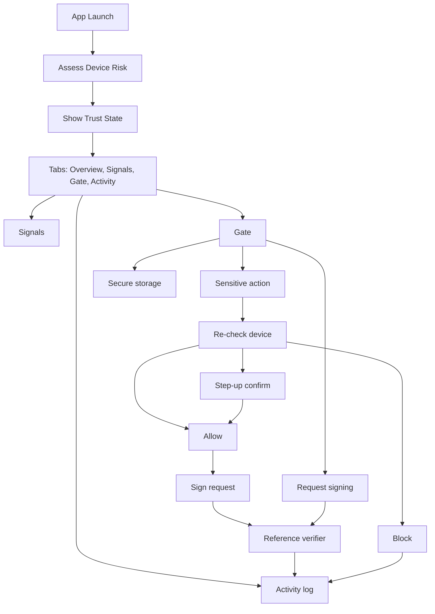

# TrustGate Android

I built TrustGate Android to show how a mobile client can treat device integrity as a risk signal before allowing sensitive actions.

It is not a banking app and it is not bypass-proof security. It is a public-safe Android security lab covering device-risk checks, sensitive action gating, request signing, secure local storage, and local security events.

## What It Proves

- Device-risk signal collection from root, emulator, debugger, and installer-source checks
- Explainable scoring: every verdict shows the rule that produced it and the points behind it
- Risk-based gating for a payment-like action, re-checked on every attempt
- Step-up confirmation with the device's biometrics or screen lock for medium risk
- One end-to-end protected action: check, decide, confirm, sign, verify, log
- HMAC request signing plus a reference verifier that rejects replays, edited bodies, and stale requests
- Local security event logging that explains decisions, with JSON export through the share sheet
- Encrypted local storage for reference session and risk state
- Certificate pinning example code that stays disabled by default
- Kotlin-first Android structure with unit tests and CI

## App Flow



## Screenshots

Real screenshots for the app, tests, CI, and repository are committed under [`docs/screenshots`](docs/screenshots). The full capture notes live in [docs/SCREENSHOT_GUIDE.md](docs/SCREENSHOT_GUIDE.md).

<table>
  <tr>
    <td><br />Trust overview</td>
    <td><br />Device risk details</td>
  </tr>
  <tr>
    <td><br />Sensitive action allowed</td>
    <td><br />Sensitive action blocked</td>
  </tr>
  <tr>
    <td><br />Request signing reference flow</td>
    <td><br />Secure storage reference values</td>
  </tr>
  <tr>
    <td><br />Activity log</td>
    <td><br />Fresh `./gradlew test` output</td>
  </tr>
  <tr>
    <td><br />GitHub Actions run summary</td>
    <td><br />GitHub branch overview</td>
  </tr>
</table>

## Security Model

The app treats client-side checks as risk signals. A rooted, emulated, or debug-exposed environment does not prove malicious behavior, but it does justify more caution before allowing a sensitive action.

Every verdict carries the rule that produced it: a single high-severity signal, a score at or above a threshold, or nothing strong enough. The Signals tab shows that rule with a point-by-point breakdown, so a decision can be checked by hand.

Medium risk asks for step-up confirmation through the system biometric prompt (biometrics or the screen lock). A device with no screen lock has nothing to step up to, so it falls back to an explicit tap, and the audit log records which method was used.

The request-signing flow shows canonical request construction, body hashing, timestamp and nonce headers, and an HMAC signature. A reference verifier plays the server's part: it recomputes the signature with a constant-time comparison, enforces a five-minute timestamp window, and accepts each nonce once. The Signing screen lets you replay a request, edit its amount, or deliver it late and see each one rejected for a different reason. The reference key is intentionally local and hardcoded so the limitation is explicit.

Encrypted local storage keeps a reference session token, the last assessed risk level, and a small UI preference away from plain shared preferences.

## Run Locally

1. Install Android Studio with Android SDK Platform 35 and Build Tools 35.0.1.
2. Create a local `local.properties` or export `ANDROID_HOME` / `ANDROID_SDK_ROOT`.
3. Run:

```bash
./gradlew test
./gradlew assembleDebug
```

## Tests

Core coverage includes:

- Risk scoring to `LOW`, `MEDIUM`, and `HIGH`, including the reason recorded for each path
- Simulated profiles scored through the real scorer so they can't claim a level their signals don't produce
- Sensitive-action decisions for all risk levels
- Deterministic request signing
- Verification: acceptance, replay, edited body or path, foreign key, stale and future timestamps, missing or malformed headers, and nonce retention
- Security events for assessments, blocked and cancelled actions, confirmation method, verifier rejections, and quiet re-checks that only log real changes

Run locally:

```bash
./gradlew test
./gradlew lint
```

## Project Structure

```text
app/src/main/java/id/fatarc/trustgate/
├── MainActivity.kt
├── core/
│   ├── crypto/
│   ├── security/
│   └── storage/
├── data/
│   └── securityevent/
├── domain/
│   ├── actiongate/
│   ├── events/
│   ├── risk/
│   └── signing/
└── ui/
    ├── about/
    ├── events/
    ├── gate/
    ├── home/
    ├── payment/
    ├── risk/
    ├── signing/
    └── storage/
```

## Limitations

- Client-side checks are not bypass-proof
- No real payment processing or bank integration
- No live device attestation backend
- No production key management for request signing
- No commercial obfuscation or anti-tamper tooling
- Certificate pinning is educational and would need rotation planning in a real app

## Docs

- [docs/THREAT_MODEL.md](docs/THREAT_MODEL.md)
- [docs/SECURITY_MODEL.md](docs/SECURITY_MODEL.md)
- [docs/SCREENSHOT_GUIDE.md](docs/SCREENSHOT_GUIDE.md)
- [docs/LIMITATIONS.md](docs/LIMITATIONS.md)
