# TrustGate

I built TrustGate to show how a mobile payment can be protected end to end: an Android app that checks the phone it runs on and holds hardware-backed keys, and a server that decides whether each payment goes through, asks for confirmation, or is blocked.

The phone only gathers evidence. The server decides, from the phone's hardware attestation, Google Play Integrity, the phone's own report, and the account's payment history. Nothing secret ships in the app, so taking the app apart gets an attacker nothing the server will accept.

It isn't a banking app, and no client-side check is bypass-proof. [LIMITATIONS.md](docs/LIMITATIONS.md) says where the edges are.

<p align="center"></p>

## What it does

**The server decides**
- Registers each key from its **hardware attestation**: pinned Google roots, the revocation list, verified boot, a locked bootloader, and the app's own package and signing certificate.
- Weighs **Play Integrity**, bound to the exact report the phone signed. That includes the optional verdicts: apps that can see or control the screen, Play Protect, licensing, and token farming.
- Scores the phone's report from its **own catalog**, so a tampered app can't lower a severity.
- **Binds each payment to what it approved**: the payee, amount, and currency it weighed are the only ones it will charge.
- Notices payments **unlike the account's habits**, such as a first payment to a payee, an amount far above the usual, or an hour it never pays at, and asks for confirmation.
- Puts phones on **accounts**. A new phone joins with a one-time code and gets in only when a phone already on the account approves it with its screen lock.
- Remembers **blocked and returning phones** through Play Integrity's device recall, so wiping a phone doesn't wipe its record.
- **Limits** how much and how fast one account can pay, and keeps new phones to small amounts. The limits are enforced when charging and hold across phones and key rotations.
- Refuses **replayed, edited, late, and foreign** requests through one-time challenges, signatures over every field, and a five-minute window.
- Charges **exactly once** per idempotency key, whatever the network does.
- **Rotates and revokes** keys: a key vouches for its successor, a phone can remove itself, and operators can revoke one.
- Keeps a **hash-chained audit log**, written with each change, checked at startup, and **checkpointed outside the database**: signed by a separate key and, optionally, timestamped by an outside authority.
- Serves **HTTPS only**, pinned by the app, with per-client rate limits.

**The phone helps**
- Keeps a **P-256 device key** and a **step-up key** in Keystore. The step-up key only signs after biometrics or the screen lock, through `BiometricPrompt` with a `CryptoObject`.
- Checks for **root, emulators, and debugging**, and for the signs of a **scam in progress**: an active call, an app reading the screen, the screen being recorded.
- **Warns** when what the server found looks like someone talking the person into paying, and offers **Google Play's own fix** where there is one.
- **Hides overlays** on payment screens, ignores taps through them, and blocks capture in release builds.
- **Seals stored values** with AES-GCM under a Keystore key, and keeps them out of backups.

**The repository is guarded too**
- Gradle **verifies the checksum of every dependency**, and every CI action is **pinned to a commit**.
- **CodeQL**, **mobsfscan**, dependency review, Dependabot, and OpenSSF **Scorecard** run in CI.
- **Jazzer fuzzes** the hand-written parsers for attestation chains, the revocation list, and integrity tokens, nightly.
- Release builds carry **signed build provenance**, checkable with `gh attestation verify`.
- An **attack lab** throws 18 attacks at the running server, and the same attacks run in the tests.

## How a payment works

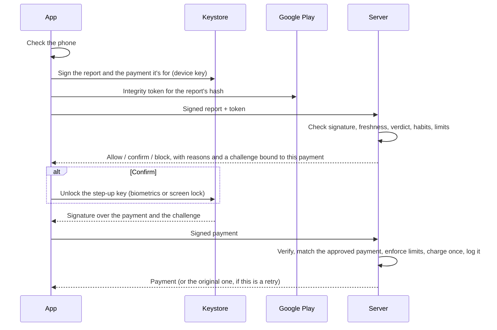

## Screenshots

Real screenshots from the emulator, the test run, the attack lab, and GitHub are in [`docs/screenshots`](docs/screenshots); [SCREENSHOT_GUIDE.md](docs/SCREENSHOT_GUIDE.md) says how each was taken.

<table>
  <tr>
    <td>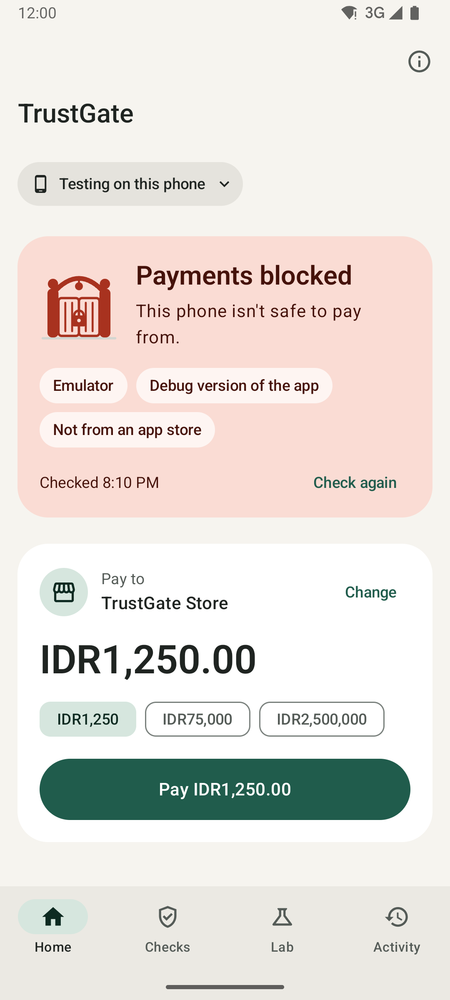<br />This phone, checked</td>
    <td>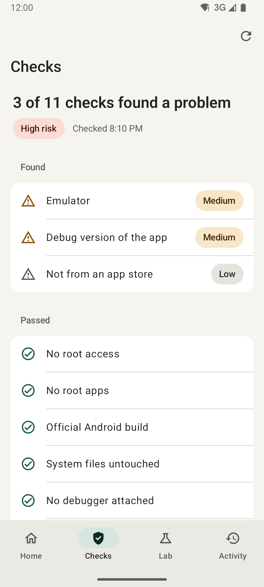<br />What was found, what passed</td>
    <td>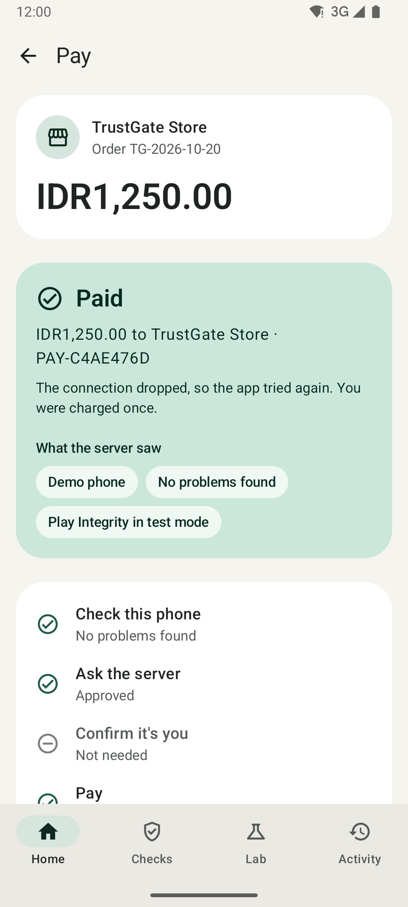<br />Charged once after a lost reply</td>
  </tr>
  <tr>
    <td>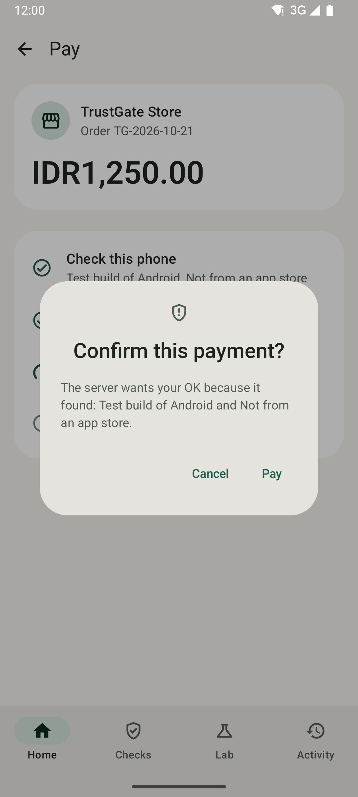<br />The server asks for your OK</td>
    <td>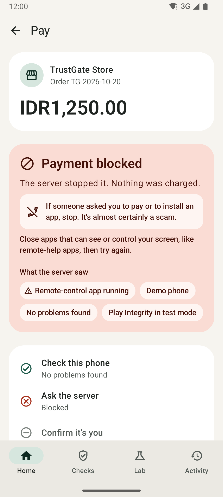<br />Blocked during a likely scam</td>
    <td>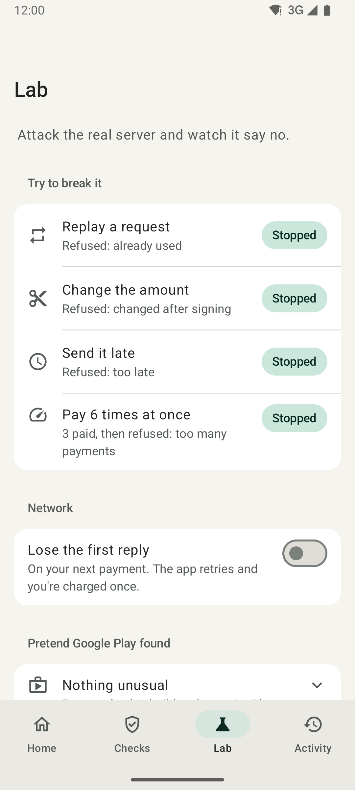<br />Attacks from the app, stopped</td>
  </tr>
  <tr>
    <td>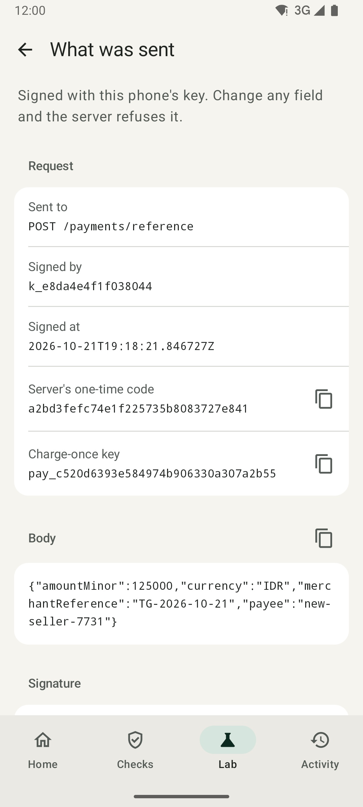<br />What was signed and sent</td>
    <td>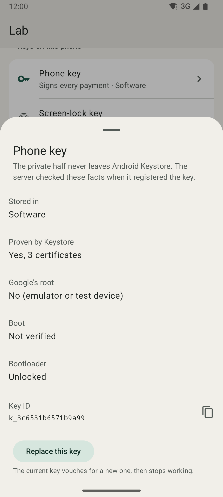<br />The phone key, and replacing it</td>
    <td>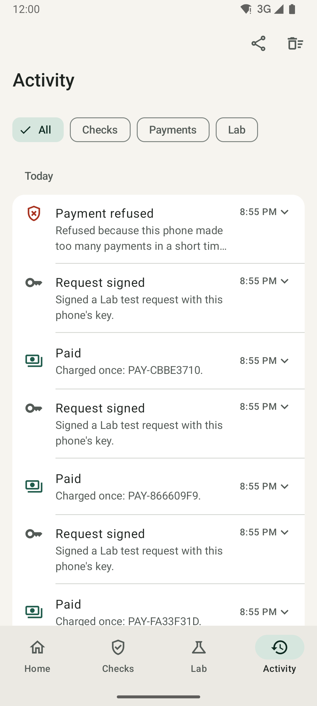<br />Activity</td>
  </tr>
</table>

<p>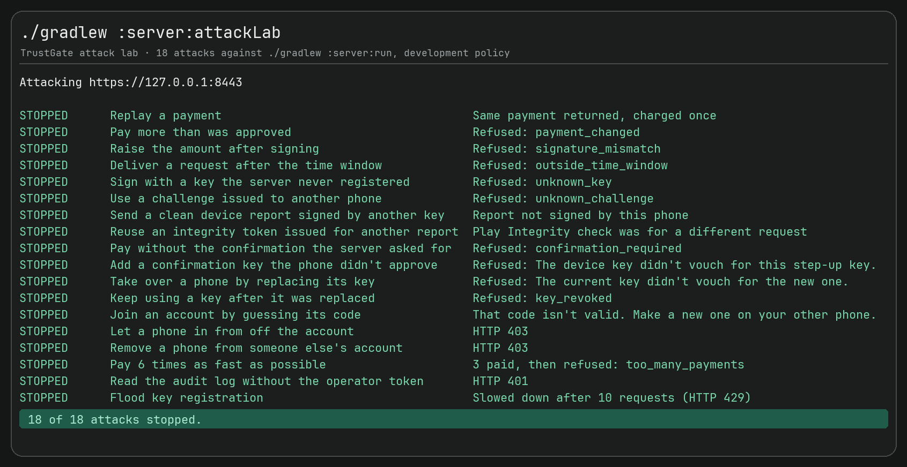</p>
<p>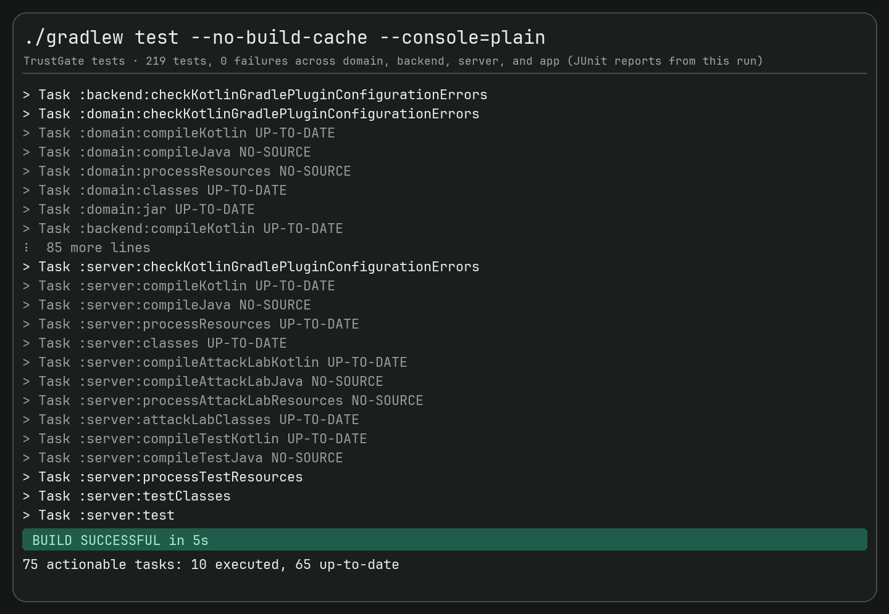</p>

| | |
| --- | --- |
| <br />GitHub Actions on `main` | <br />The repository |

## Architecture

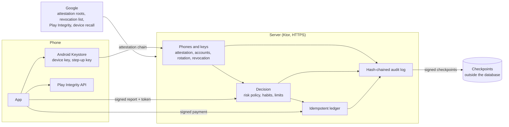

| Module | What it holds |
| --- | --- |
| `domain` | The protocol both ends share: signing scheme, wire messages, signal catalog, scoring |
| `backend` | The server's rules: attestation and risk policies, habit checks, limits, accounts, key lifecycle, the audit log and its checkpoints, with an in-memory store for tests |
| `server` | The HTTPS server, SQLite store with migrations, Play Integrity decoding and device recall, revocation list, rate limits, admin routes, the checkpoint file and timestamps, and the attack lab |
| `app` | The Android app: checks, Keystore keys, integrity tokens, the payment flow, and the UI |

## Run it

You need Android Studio with SDK Platform 35, an emulator, and JDK 17 or later.

```bash
./gradlew :server:run      # the server, on https://127.0.0.1:8443, development policy
./gradlew installDebug     # the app, which reaches the server as 10.0.2.2
```

The first run generates the server's TLS key, certificate, operator token, and audit anchor key into `server/build/dev-tls`; the debug app trusts only that certificate. To try the step-up key on an emulator, set a screen lock PIN, then return to the app.

```bash
./gradlew :server:run -Ptrustgate.policy=strict   # production rules
./gradlew :server:attackLab                       # attack the running server
```

The operator routes take the token from `server/build/dev-tls/admin-token`:

```bash
curl --cacert server/build/dev-tls/server.pem \
  -H "Authorization: Bearer $(cat server/build/dev-tls/admin-token)" \
  https://127.0.0.1:8443/admin/audit
```

`POST /admin/audit/checkpoint` checkpoints the log right away; `/admin/audit` reports whether the log still matches every checkpoint in `server/build/audit-checkpoints.jsonl`.

### Configuration

| Where | Setting | What it does |
| --- | --- | --- |
| App (Gradle property) | `trustgate.cloudProjectNumber` | Google Cloud project linked to Play Integrity; without it, debug builds make up their answers |
| App | `trustgate.serverUrl`, `trustgate.serverPins` | Release server and its key pins |
| Server (environment) | `TRUSTGATE_POLICY` | `strict` (default) or `development` |
| Server | `TRUSTGATE_PACKAGE`, `TRUSTGATE_SIGNING_DIGESTS` | The app's package and signing certificate digests |
| Server | `TRUSTGATE_PLAY_INTEGRITY_CREDENTIALS` | Service account that may decode the app's integrity tokens |
| Server | `TRUSTGATE_MIN_PATCH_LEVEL`, `TRUSTGATE_MIN_APP_VERSION` | Oldest security patch (YYYYMM) and app version code accepted |
| Server | `TRUSTGATE_REQUIRE_STRONG_INTEGRITY` | Whether phones without strong integrity must confirm (default `true`) |
| Server | `TRUSTGATE_DEVICE_RECALL` | `on` to mark blocked and enrolled phones through device recall; needs the Play Integrity credentials and device recall turned on in Play Console |
| Server | `TRUSTGATE_ADMIN_TOKEN_FILE` | Operator token; without one, the admin routes are off |
| Server | `TRUSTGATE_ANCHOR_KEYSTORE`, `TRUSTGATE_ANCHOR_PASSWORD_FILE` | PKCS#12 key that signs audit checkpoints; without one, there are no checkpoints |
| Server | `TRUSTGATE_CHECKPOINTS`, `TRUSTGATE_CHECKPOINT_MINUTES` | Where checkpoints are appended (default: next to the database) and how often (default: every 10 minutes) |
| Server | `TRUSTGATE_TSA_URL`, `TRUSTGATE_TSA_CERT_SHA256` | An RFC 3161 timestamping authority for checkpoints, and the SHA-256 of each of its certificates to trust; off by default |
| Server | `TRUSTGATE_TLS_KEYSTORE`, `TRUSTGATE_TLS_PASSWORD_FILE`, `TRUSTGATE_DATABASE`, `TRUSTGATE_HOST`, `TRUSTGATE_PORT` | TLS, storage, and where it listens |

## Tests

```bash
./gradlew test       # 211 tests across every module
./gradlew lint
./gradlew assembleRelease
```

- **Attestation:** parsing, Google roots, revocation, app identity, origin, boot state, patch level, minimum app version.
- **Decisions:** scoring from the catalog, every Play Integrity verdict and its fix, device recall, scam signals, habit checks, demo phones, mock verdicts.
- **Payments:** bound to what was approved, so a changed payee or amount is refused.
- **Limits:** authorizations collected in advance, the payment window, the daily amount, new phones, and phones sharing an account.
- **Accounts:** joining with a code, approval by a phone on the account and by its screen-lock key, reused, guessed, and expired codes, and removing a lost phone.
- **Key lifecycle:** step-up keys vouched for by the device key, rotation, removal, operator revocation, and limits surviving rotation.
- **Audit log:** an intact chain, an edited entry caught from that entry on, and a log rewritten with every hash recomputed caught against signed checkpoints, with a real RFC 3161 authority run in the test.
- **Parsers:** a Jazzer fuzz test for each, replaying its saved inputs on every run.
- **Server:** every route over HTTP, rate limits, admin authentication, and SQLite migrations from older databases.
- **The attack lab**, run against the routes.
- **The app:** payment client retries, key registration and rotation, storage sealing, and the ViewModel's payment, confirmation, Lab, and recovery flows.

## Docs

- [SECURITY_MODEL.md](docs/SECURITY_MODEL.md): what each part enforces
- [THREAT_MODEL.md](docs/THREAT_MODEL.md): who attacks, how, and what stops them
- [ATTACK_LAB.md](docs/ATTACK_LAB.md): attacking it yourself
- [MASVS.md](docs/MASVS.md): the OWASP MASVS controls, one by one
- [SUPPLY_CHAIN.md](docs/SUPPLY_CHAIN.md): dependencies, CI, fuzzing, build provenance, and secrets
- [LIMITATIONS.md](docs/LIMITATIONS.md): what it doesn't do
- [SECURITY.md](SECURITY.md): reporting a vulnerability
