# TrustGate Android

I built TrustGate Android to show how a mobile client can treat device integrity as a risk signal before allowing sensitive actions, and how the pieces around that decision fit together: hardware-backed keys, step-up confirmation, signed requests, and payments that stay correct when the network misbehaves.

It is not a banking app and it is not bypass-proof security. It is a public-safe Android security lab. Everything runs on the device, including a reference backend that plays the server's part, so the whole flow can be explored without accounts or a network.

<p align="center">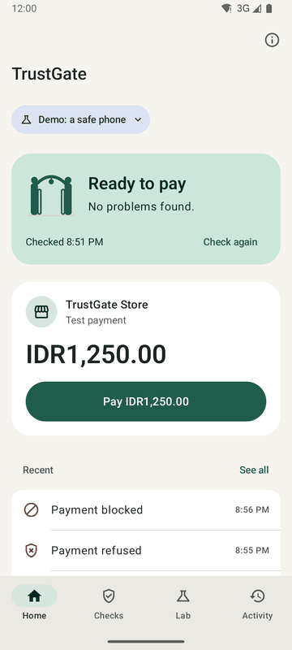</p>

## What It Proves

- **Device-risk signals** from root, emulator, debugger, and installer-source checks
- **Explainable scoring**: every verdict shows the rule that produced it and the points behind it
- **A server-side decision**: the reference backend, not the UI, decides allow, step-up, or block, and says which key must sign
- **Hardware-backed keys**: P-256 keys generated in Android Keystore (StrongBox when available) sign every request; the private keys never leave the device
- **Key attestation**: the backend reads each key's attestation certificate chain, checks it certifies that key and a one-time challenge, and reports where the key lives, verified boot state, and bootloader lock
- **Cryptographic step-up**: medium risk requires a signature from a key that only signs after biometrics or the screen lock, unlocked through `BiometricPrompt` with a `CryptoObject`. Faking the prompt's callback produces nothing the backend accepts
- **Replay protection**: server-issued one-time challenges, a five-minute timestamp window, and constant-time signature checks
- **Payment reliability**: idempotency keys, retries with exponential backoff and jitter, and a switch that loses responses on purpose to show a retried payment is charged once
- **Hardened storage**: AES-256-GCM under a Keystore key, each value bound to its name, migrated from the deprecated `EncryptedSharedPreferences`, and kept out of backups and device transfers
- **Hardened screens**: release builds block screenshots and screen recording on sensitive screens, and taps through overlays are ignored
- **An audit log** that explains every decision, exportable as a JSON file
- **R8** shrinking and obfuscation for release builds
- **Tests**: unit tests for the scorer, signer, attestation parser, backend, payment client, storage sealing, and the ViewModel's flows and race conditions

## How a Protected Payment Works

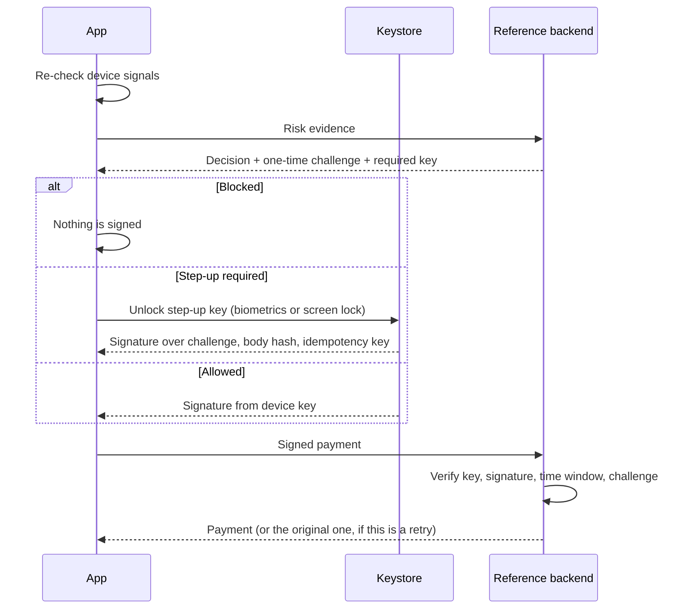

## Screenshots

Real screenshots for the app, tests, CI, and repository are committed under [`docs/screenshots`](docs/screenshots). The full capture notes live in [docs/SCREENSHOT_GUIDE.md](docs/SCREENSHOT_GUIDE.md).

<table>
  <tr>
    <td>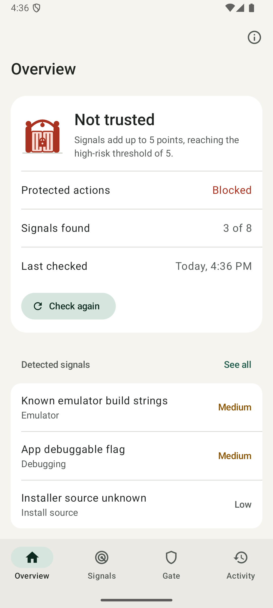<br />Trust overview</td>
    <td>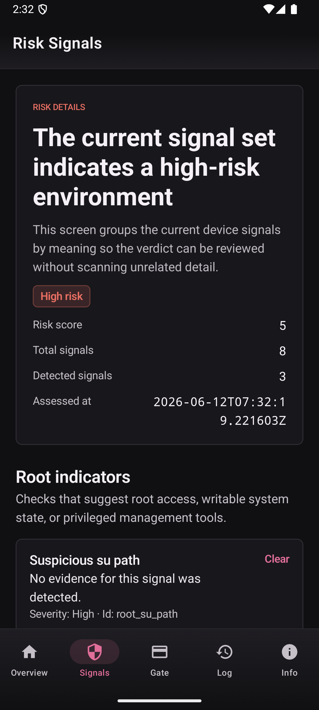<br />Risk signals and why they add up</td>
  </tr>
  <tr>
    <td>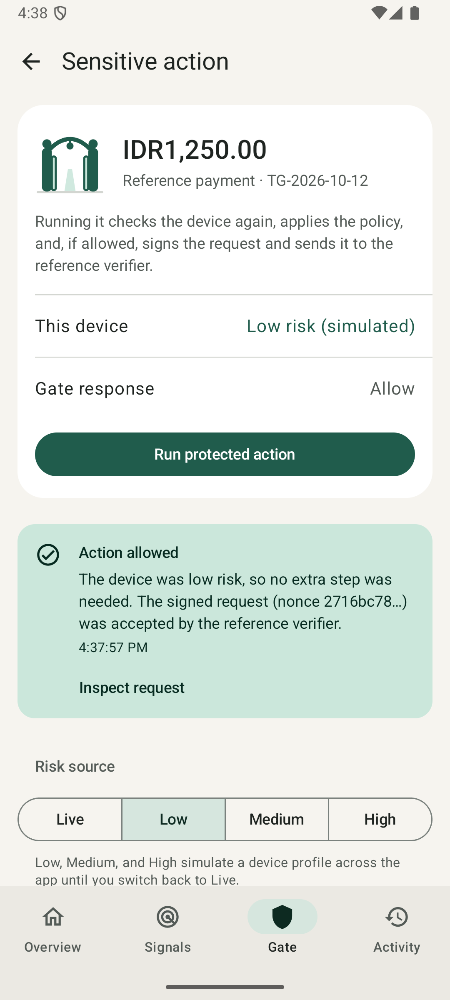<br />Allowed, and charged once after a lost response</td>
    <td>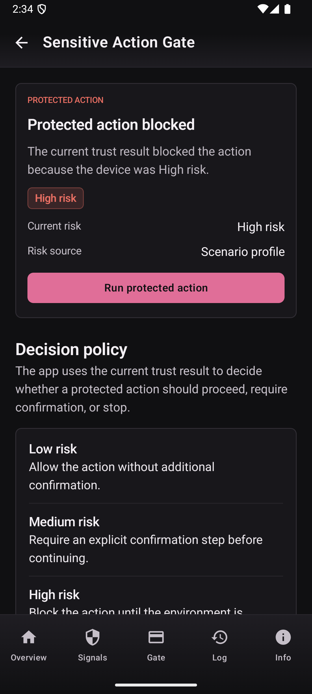<br />Blocked, nothing signed</td>
  </tr>
  <tr>
    <td>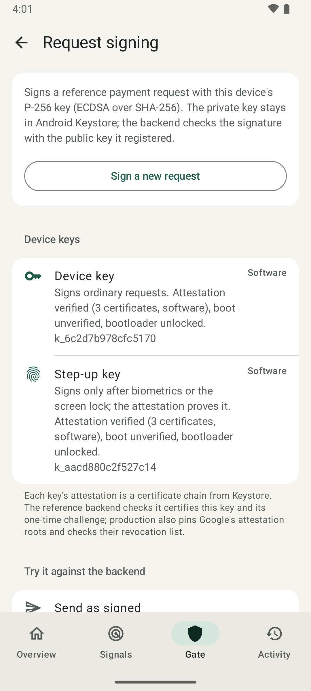<br />Device and step-up keys with their attestation</td>
    <td>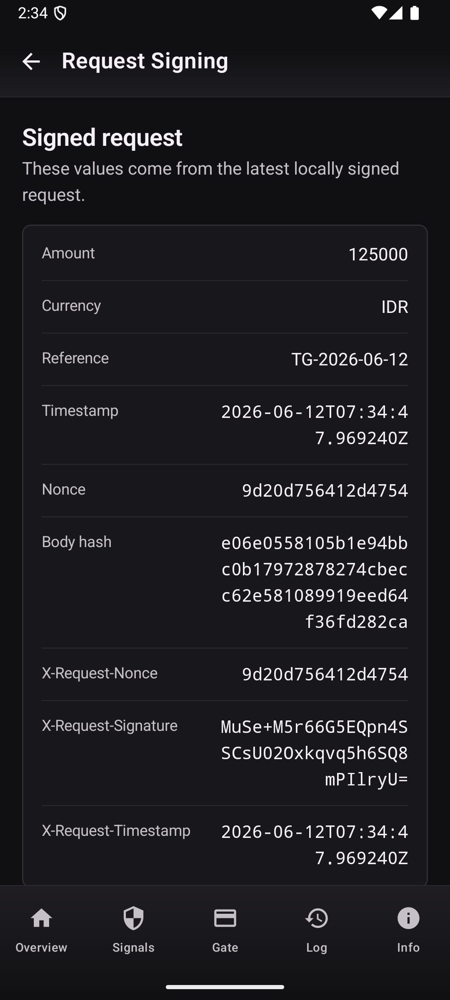<br />Backend responses to genuine and tampered requests</td>
  </tr>
  <tr>
    <td>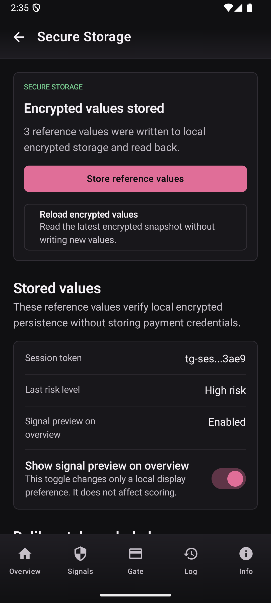<br />Secure storage reference values</td>
    <td>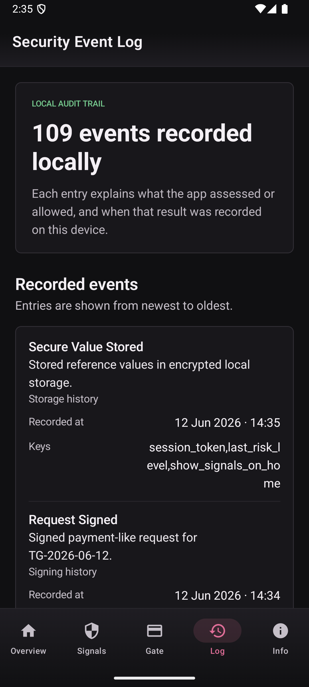<br />Activity log</td>
  </tr>
  <tr>
    <td>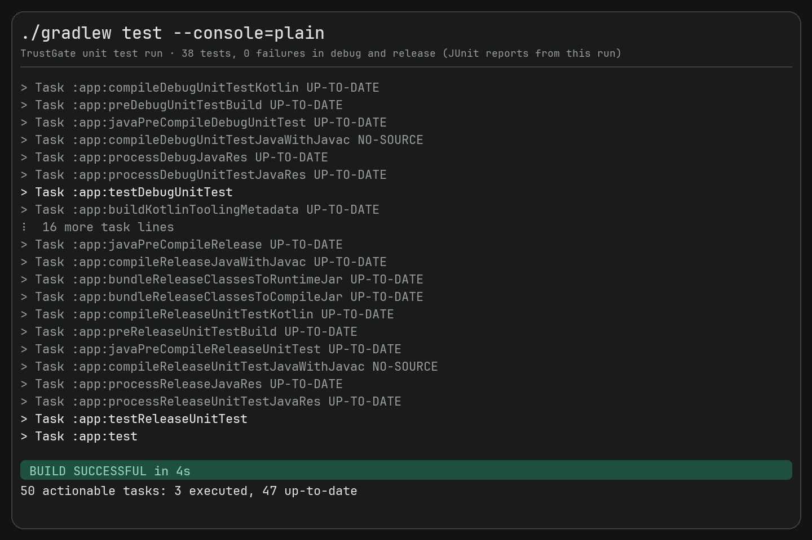<br />Fresh <code>./gradlew test</code> output</td>
    <td>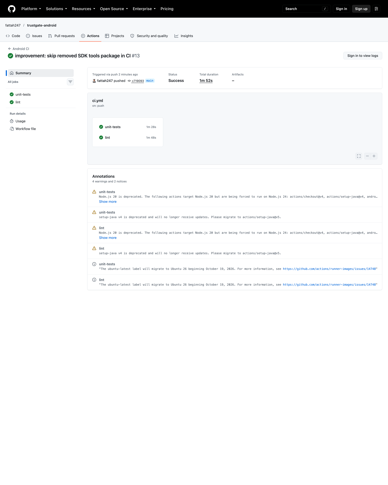<br />GitHub Actions run summary on <code>main</code></td>
  </tr>
  <tr>
    <td>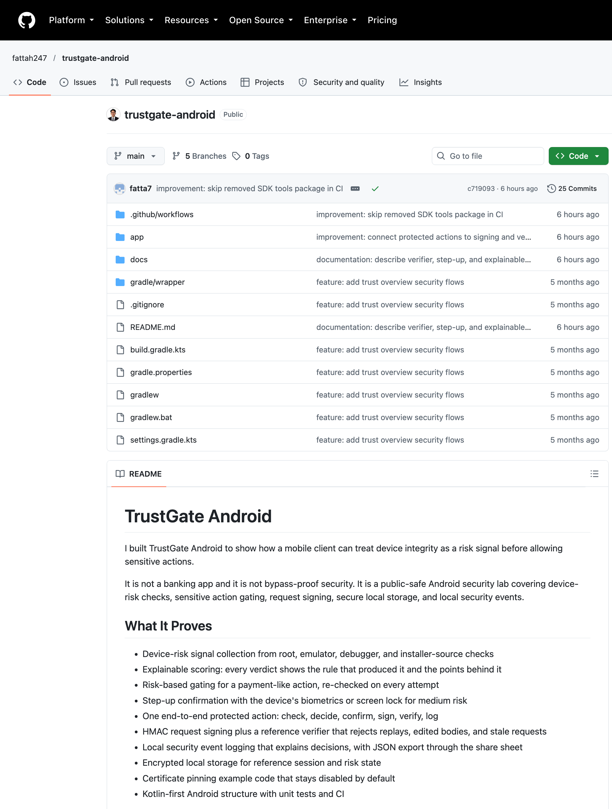<br />GitHub branch overview</td>
    <td></td>
  </tr>
</table>

## Production Architecture

TrustGate runs its backend in-process so the flow is inspectable without infrastructure. This is where each part would live in a real deployment, and what this repo does in its place.

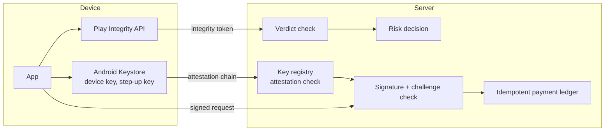

| Concern | In this repo | In production |
| --- | --- | --- |
| Device integrity | On-device heuristic checks | Play Integrity verdict, decrypted and checked on the server, bound to the action with a request hash |
| Gate decision | `ReferenceBackend` in the app process | A server service; the app only sends evidence |
| Request signing | Keystore P-256 keys, registered with their attestation | Same, with the registry persisted server-side |
| Attestation trust | Chain must verify, certify the key, and carry the challenge | Also pin Google's attestation roots and check the revocation list |
| Step-up | Keystore key bound to biometrics or the screen lock, unlocked through `BiometricPrompt` | Same, optionally plus server-driven step-up such as one-time codes |
| Replay protection | One-time challenges and nonces held in memory | The same checks backed by a shared store with expiry |
| Retries | Idempotency keys and an in-memory ledger | A durable ledger, with reconciliation for outcomes the client never learned |
| Transport | No network | TLS with certificate pinning (`PinnedHttpClientFactory`, off by default here) and backup pins |

## Security Model

The app treats client-side checks as risk signals. A rooted, emulated, or debug-exposed environment does not prove malicious behavior, but it does justify more caution before allowing a sensitive action.

Every verdict carries the rule that produced it: a single high-severity signal, a score at or above a threshold, or nothing strong enough. The Signals tab shows that rule with a point-by-point breakdown.

The backend makes the gate decision and binds it to a one-time challenge. For medium risk it requires the step-up key's signature. It only accepts a step-up key that the device key vouched for, and refuses one whose attestation shows it signs without authentication. A device with no screen lock has nothing to step up to, so it falls back to a tap confirmation that is signed into the request, and the audit log records which method was used.

See [docs/SECURITY_MODEL.md](docs/SECURITY_MODEL.md) and [docs/THREAT_MODEL.md](docs/THREAT_MODEL.md) for the details.

## Run Locally

1. Install Android Studio with Android SDK Platform 35 and Build Tools 35.0.1.
2. Create a local `local.properties` or export `ANDROID_HOME` / `ANDROID_SDK_ROOT`.
3. Run:

```bash
./gradlew test
./gradlew assembleDebug
```

To try the step-up key on an emulator, set a screen lock PIN in Settings, then return to the app; it registers the step-up key automatically.

## Tests

Unit tests run on the JVM, using software keys where the app uses Keystore:

- Risk scoring to `LOW`, `MEDIUM`, and `HIGH`, with the reason recorded for each path, and simulated profiles scored through the real scorer
- Request preparation: every signed field changes the bytes to sign, and canonical bodies escape correctly
- Attestation: KeyDescription parsing, security levels, root of trust, and whether a key requires authentication, checked against certificate chains the tests build and sign
- Backend: registration and attestation policy, step-up keys vouched for by the device key, one-time challenges bound to their purpose, replay, edited and unusable bodies, foreign keys and challenges, expired challenges, time windows, step-up enforcement, tap confirmation, and idempotency keys scoped per device
- Payment client: a lost response is retried and charged once, retries back off exponentially, and when every response is lost the outcome is reported as unknown
- Key registration: both keys at launch, a step-up key the system deleted replaced, and a removed screen lock downgrading the device at the backend
- Storage sealing: values round-trip, and moved, altered, or foreign-key values don't open
- ViewModel: each protected-action path, the step-up key actually signing, a device turning high risk mid-confirmation, a profile switch mid-payment, and step-up key invalidation

```bash
./gradlew test
./gradlew lint
./gradlew assembleRelease
```

## Project Structure

```text
app/src/main/java/id/fatarc/trustgate/
├── MainActivity.kt
├── core/
│   ├── attestation/   Key attestation parsing and checks
│   ├── backend/       Reference backend, transport, payment client
│   ├── crypto/        Certificate pinning example
│   ├── keys/          Keystore keys and their registration
│   ├── security/      Device signals and the audit trail
│   └── storage/       Keystore-sealed values
├── data/
│   └── securityevent/
├── domain/
│   ├── actiongate/
│   ├── events/
│   ├── risk/
│   └── signing/       Signing protocol and request model
└── ui/
    ├── about/
    ├── events/
    ├── gate/
    ├── home/
    ├── payment/
    ├── risk/
    ├── signing/
    └── storage/
```

## Limitations

- Client-side checks are not bypass-proof
- The reference backend runs inside the app, so it shows what a server checks but isn't an independent authority
- No Play Integrity verdict, payment processor, or fraud engine
- Attestation isn't checked against Google's roots or revocation list
- Certificate pinning is educational and off by default
- No commercial obfuscation or anti-tamper tooling beyond R8

## Docs

- [docs/THREAT_MODEL.md](docs/THREAT_MODEL.md)
- [docs/SECURITY_MODEL.md](docs/SECURITY_MODEL.md)
- [docs/SCREENSHOT_GUIDE.md](docs/SCREENSHOT_GUIDE.md)
- [docs/LIMITATIONS.md](docs/LIMITATIONS.md)
